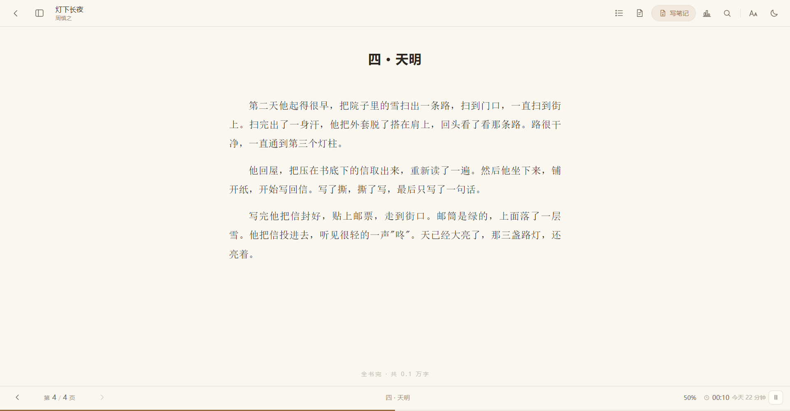
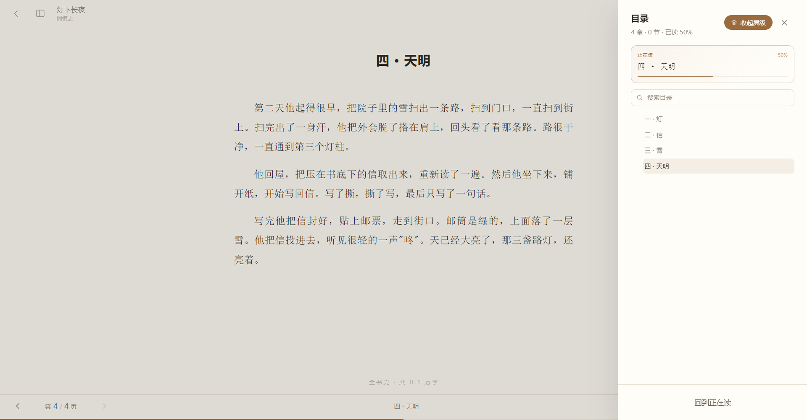

<div align="center">


# 墨栖 · Moqi

**给文字一个可以久留的地方**

一款 Windows 桌面中文阅读器。没有账号、没有广告、没有推荐、没有云同步。<br />
打开先看到自己的工作台，翻开书就只剩文字。

[](LICENSE)
[](#)
[](#)
[](#)
[](#)

**GitHub** · https://github.com/keziea/MoQi 　|　 **Gitee** · https://gitee.com/azs_A/MoQi


</div>

---

## 这是什么

一个给**长时间阅读**用的桌面软件。

它不追求功能堆砌，只追求一件事：**让一个人翻开书之后，忘了软件的存在**。

- 版心只占屏幕一半，一行 33 字左右——这是纸书的密度
- 首行缩进两格、两端对齐、标点不出现在行首
- 默认分页，底部是「第 N / M 页」，不是无尽的滚动条
- 关掉再开，精确回到上次那一行；换字号、改窗口大小也不会丢

## 它不是什么

| 不是 | 原因 |
|---|---|
| ❌ 不是书城 | 没有任何在线书源、推荐、排行榜。书是你自己的文件 |
| ❌ 不是云阅读 | 没有账号、没有同步、没有遥测。断网照常用 |
| ❌ 不是格式转换器 | 只负责读，不改你的原文件 |
| ❌ 不是全平台 | 目前只有 Windows（10 / 11，x64） |

---

## 界面

> 以下截图使用**内置示例书库**：4 本原创虚构作品，分别对应 EPUB / MOBI / PDF / TXT 四种格式。
> 不含任何真实书籍内容——书名、作者、封面、正文全部为演示而虚构。

### 工作台：先把今天安排好

左侧五个入口，首页有今日目标环、继续阅读、连续阅读天数、最近笔记和书架一角。


### 书架：同一本书的多个版本，合并成一张卡

格式 pill 直接摆在下方，点一下就能换一种文件读，不用翻右键菜单。


### 正文：像纸书，而不是像网页

版心只占屏幕一半，一行 33 字，首行缩进两格、两端对齐。底部是「第 N / M 页」，不是无尽的滚动条。



### 目录：严格按原书层级

这本书几章几节，目录就是几章几节，父子关系和原文件一致，不自己猜。



### 书籍详情：进度、时长、笔记集中在一屏

下面直接选版本，EPUB 排版最好就默认选它。


### 阅读统计：不跟别人比，只跟自己比

7 / 30 / 56 天的阅读时长、读得最多的书、笔记习惯放在一起，能一键复制成复盘文字。


### 阅读记录：把坐下来读书的日子收好

一年热力图 + 按天时间线，每天读了哪本书、多久，一目了然。


---

## 功能一览

### 工作台
启动进入「我的阅读」：左侧首页 / 书架 / 笔记 / 阅读统计 / 阅读记录，不再把功能全塞进书本页面。首页有今日目标环、继续阅读、今天读了多久、连续阅读、最近笔记和书架一角。

### 书架
书库搜索、在读 / 读完 / 未读筛选、最近 / 书名排序；继续阅读卡永远在最上面。

### 读到哪里，永远记得
- **自动续读**：翻页或滚动时悄悄记住位置，关掉再开精确回到同一段
- **「读到此处」标记**：单击某一段，左侧出现书签和竖线；下方浮出「上次标记在《第 3 章》回到那里」

### 划一句，写一句
选中任意文字（可跨段落）浮出四色高亮和「写笔记」；笔记面板按颜色筛选、点击回原文、一键复制全部笔记、导出 Markdown。

### 时间与数据
底栏实时走秒，导航栏有大时钟；数据面板有「今日小结 / 本周 / 这本书 / 我的笔记」四种模板，一键复制成文字。

### 数据带得走
阅读进度、笔记、阅读时长能一键导出成一个文件夹，换电脑或重装系统时点「导入我的数据」选中它就行。导入只补不覆盖，重复导入也不会出现两份一样的笔记；导入前还会自动备份一份原数据。

### 眼睛不累
四套主题：纸白 / 米黄 / 护眼绿 / 夜间。字号 14–32、行距 4 档、字体宋 / 黑 / 楷、版心 5 档，随手就调。

---

## 快速开始

### 一、下载（点蓝字，直接开始下载）

**🇨🇳 国内用户（Gitee，速度快）**

| 版本 | 下载 |
|---|---|
| **安装版**　76MB　装进电脑，桌面有图标　**← 推荐** | 👉 **[点此下载](https://gitee.com/azs_A/MoQi/releases/download/v0.4.2/Moqi-0.4.2-Setup.exe)** |
| **解压版**　66MB　不装进系统，解压就用 | 👉 **[点此下载](https://gitee.com/azs_A/MoQi/releases/download/v0.4.2/Moqi-0.4.2-portable.7z)** |

**🌍 国外用户（GitHub）**

| 版本 | 下载 |
|---|---|
| **安装版**　76MB　**← 推荐** | 👉 **[点此下载](https://github.com/keziea/MoQi/releases/download/v0.4.2/Moqi-0.4.2-Setup.exe)** |
| **解压版**　66MB | 👉 **[点此下载](https://github.com/keziea/MoQi/releases/download/v0.4.2/Moqi-0.4.2-portable.7z)** |

> **不知道怎么选？下安装版。** 双击后会出现安装向导，**可以自己选装到哪个盘、哪个文件夹** —— 默认位置藏在 `C:\Users\你的用户名\AppData\Local\Programs\` 里，不好找，建议在向导里改成 `D:\Moqi` 这种一眼能看到的地方。然后是桌面图标，以后从桌面打开。
>
> 解压版需要用 WinRAR / 7-Zip / Bandizip 解压（都是免费软件），解压后双击里面的「墨栖.exe」。
>
> ⚠️ 解压版**别放在中文名字的文件夹里**（比如「我的书」「新建文件夹」），可能打不开。
> 放到 D 盘一个英文名的文件夹最稳，例如 `D:\Moqi`。

**想看源码、或者找历史版本？**
[GitHub 仓库](https://github.com/keziea/MoQi) ｜ [Gitee 仓库](https://gitee.com/azs_A/MoQi)

### 二、第一次用，三步就会

1. **打开软件**（双击桌面图标，或双击解压出来的「墨栖.exe」）
2. **把书拖进去**：按住你的书文件（EPUB / MOBI / PDF / TXT），拖到软件窗口里松手。
   也可以点右上角「导入书籍」自己选文件。
3. **点书的封面 → 点「阅读」**

关掉再打开，会**自动回到上次读到的那一行**，不用自己记页码。

### 三、我想改这个软件（懂技术的人看）

> 这一节写给「要改代码、自己打包」的人。只想用软件的话，上面两条就够了。

**先装两个工具（只装一次）**

| 工具 | 干什么用 | 去哪下载 |
|---|---|---|
| **Node.js 20 LTS 或更高** | 让电脑能运行、编译这个项目 | https://nodejs.org/zh-cn |
| **Git** | 把源码下载到本机 | https://git-scm.com/download/win |

装完按 `Win + R` → 输入 `cmd` → 回车，检查：

```bash
node -v          # 显示 v20.x / v22.x 就对了（最低 20）
git --version    # 显示 git version 2.x 就对了
```

**把源码拿下来，跑起来**

```bash
# 1. 下载源码（两个地址内容完全一样，国内用 Gitee 更快）
git clone https://github.com/keziea/MoQi.git moqi
# git clone https://gitee.com/azs_A/MoQi.git moqi

cd moqi

# 2. 安装依赖（第一次约 2-4 分钟，含 Electron 约 100MB）
npm install

# 3. 启动开发模式
npm run dev
```

窗口会自动弹出。改代码、保存，界面立刻刷新，不用重启。

> **国内网络说明**：仓库已自带 `.npmrc`，Electron 运行时和打包工具会自动走国内镜像。
> 如果仍然卡在下载 Electron，删掉 `node_modules\electron` 文件夹再 `npm install` 一次即可。

**常用命令**

| 命令 | 作用 |
|---|---|
| `npm run dev` | 开发模式，改代码即时生效 |
| `npm run build` | 编译一次，输出到 `dist/` 与 `dist-electron/` |
| `npm run dist` | 打 Windows 安装包，输出 `out-app\墨栖 Setup <版本>.exe` |
| `npm run pack` | 打免安装绿色版，输出到用户目录 `Moqi-portable\`（可用环境变量 `MOQI_PACK_DIR` 改） |
| `npm run typecheck` | 只做类型检查，不产出文件 |

**改完代码，怎么发一个新版本**

1. 改 `package.json` 里的 `version`（例如 `0.3.0` → `0.3.1`），`CHANGELOG.md` 记一笔
2. `npm run dist`，产物在 `out-app\`
3. 把 `out-app\墨栖 Setup 0.3.1.exe` 复制到 `release\`，**改名为** `Moqi-0.3.1-Setup.exe`
4. 用 7-Zip 把 `out-app\win-unpacked\` 压成 `release\Moqi-0.3.1-portable.7z`（LZMA2、极限压缩）
5. 提交代码，打 tag：`git tag v0.3.1` → `git push --tags`
6. 到 GitHub / Gitee 的 Releases 上传这两个文件（同 tag、同文件名、同说明）

> 打包排错见 `docs/09-构建与发布.md`。

**遇到问题**

| 现象 | 原因 | 解决 |
|---|---|---|
| `Electron failed to install correctly` | Electron 二进制没下完 | 删 `node_modules\electron`，重新 `npm install` |
| `npm install` 卡在 electron 不动 | 直连 GitHub 被重置 | 确认 `.npmrc` 存在；或临时设 `ELECTRON_MIRROR` |
| 打包报 `EBUSY` / 文件无法删除 | 杀毒软件锁住了文件 | 把项目目录加入杀毒白名单，或临时关实时防护 |
| `npm run dev` 起不来 | 5173 端口被占用 | 关掉占用程序，或改 `vite.config.mts` 里的端口 |

## 支持的格式

| 格式 | 说明 |
|---|---|
| **EPUB** | 首选。保留原书目录层级、排版、封面 |
| **MOBI** | 支持早期 Kindle 格式 |
| **PDF** | 适合影印版、扫描版 |
| **TXT** | 自动识别 UTF-8 / GBK 编码，自动分章 |

同一本书有多个格式时自动合并成一本，优先用排版最好的那份。

---

## 快捷键

| 键 | 作用 |
|---|---|
| `Ctrl + O` | 导入书籍 |
| `Ctrl + 1..5` | 切换：首页 / 书架 / 笔记 / 阅读统计 / 阅读记录 |
| `Ctrl + T` | 目录 |
| `Ctrl + N` | 笔记 |
| `Ctrl + D` | 阅读数据 |
| `Ctrl + F` | 搜索全书 |
| `Ctrl + B` | 标记 / 取消标记 |
| `Ctrl + \` | 打开 / 收起左侧导航栏 |
| `Ctrl + =` / `Ctrl + -` | 放大 / 缩小字号 |
| `Space` | 下一页 / 下翻一屏 |
| `Esc` | 关闭面板 / 返回首页 |
| `F11` | 全屏 |

记不住没关系，设置面板里列着，每个按钮也有提示。

---

## 你的数据在哪

```
%APPDATA%\moqi-reader\data\
├── library.json        书库索引
├── settings.json       阅读设置
├── books\              解析缓存（可删，会自动重建）
└── user\
    ├── progress.json   阅读进度与标记
    ├── notes.json      全部笔记
    └── sessions.json   阅读时长
```

**全部在本机，不上传、不联网。** 建议定期备份 `user` 文件夹——那里是你的笔记。

---

## 重装系统 / 换电脑怎么办

源码不会丢——推送到云端的那一刻，它就已经不在这台电脑上了。

| 要恢复什么 | 怎么做 |
|---|---|
| **程序本身** | `git clone` 一条命令，见上面「方式二：从源码运行」 |
| **阅读进度、笔记、统计** | ⚠️ **只存在本地**。重装前必须拷走 `%APPDATA%\moqi-reader\data\user\` |
| **电子书原文件** | 软件不复制你的书，只记录路径。书本身要自己留好 |

> **重装系统前**，把 `%APPDATA%\moqi-reader\data\user\` 整个文件夹拷到 U 盘或网盘。
> 里面只有三个 JSON、几 MB 大小，但那是你全部的笔记和阅读进度。
> 新系统装好、软件跑起来之后，把这个文件夹拷回同一位置，一切原样恢复。

---

## 项目结构

```
moqi-reader/
├── electron/            主进程：窗口、IPC、四种格式的解析器、本地 JSON 存储
│   ├── ipc/             主进程与界面之间的通道
│   ├── parsers/         epub / mobi / pdf / txt 解析
│   └── store/           书库、设置的读写
├── src/                 渲染进程（React）
│   ├── pages/           工作台 / 阅读器
│   ├── components/      书架、阅读器、工作台三组组件
│   ├── store/           zustand 状态
│   └── styles/          按页面拆分的样式
├── shared/              主进程与界面共用的类型定义
├── release/             发布目录：已打包的安装版与解压版，发行版附件从这里取
├── docs/                设计文档与界面截图
├── build/               图标等打包资源
└── scripts/             构建、截图、生成示例书
```

技术栈：**Electron 33 + Vite 6 + React 18 + TypeScript 5 + Tailwind 3 + zustand 5 + framer-motion**

---

## 文档

这个项目的规矩是**文档先行**：任何改动先改文档，再改代码。

| 文件 | 内容 |
|---|---|
| [`AGENTS.md`](AGENTS.md) | 项目宪法。接手前只读这一个就够：铁律、文档拓扑、改动牵连矩阵 |
| [`docs/00-项目总览.md`](docs/00-项目总览.md) | 这是什么、给谁用、不做什么 |
| [`docs/01-技术架构.md`](docs/01-技术架构.md) | 进程模型、数据流 |
| [`docs/03-数据模型与存储.md`](docs/03-数据模型与存储.md) | 本地 JSON 结构 |
| [`docs/04-书籍解析规范.md`](docs/04-书籍解析规范.md) | 四种格式怎么解、目录怎么还原 |
| [`docs/06-UI设计规范.md`](docs/06-UI设计规范.md) | 颜色、字号、间距、版心 |
| [`docs/09-构建与发布.md`](docs/09-构建与发布.md) | 打包流程与环境坑 |
| [`docs/CHANGELOG.md`](docs/CHANGELOG.md) | 每一版改了什么、牵连了谁 |

---

## 参与

欢迎提 Issue 和 PR。

- 提 Bug 请附：**系统版本、书籍格式、复现步骤**（能附截图最好）
- 改代码前请先读 [`AGENTS.md`](AGENTS.md)，里面写着什么不能动
- 截图请用 `npx electron scripts/capture-screens.js` 生成，保证和实际界面一致

---

## 许可

[MIT](LICENSE) © 2026 Moqi

随便用、随便改、随便分发，保留版权声明即可。

第三方依赖的许可见 `LICENSES.chromium.html` 与各依赖包自带声明；Electron 相关见 `LICENSE.electron.txt`。
